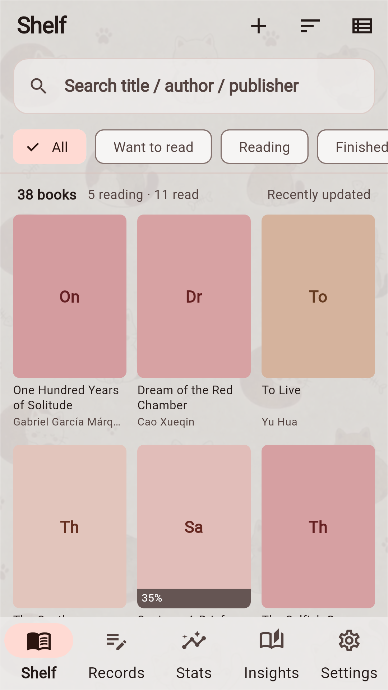
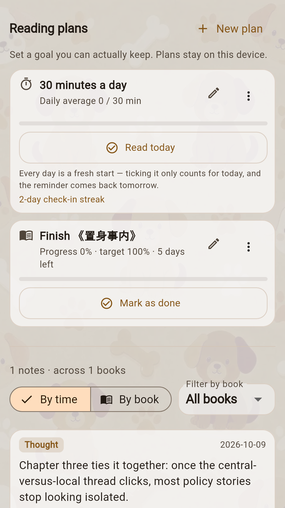
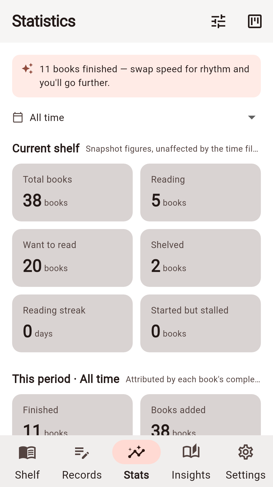
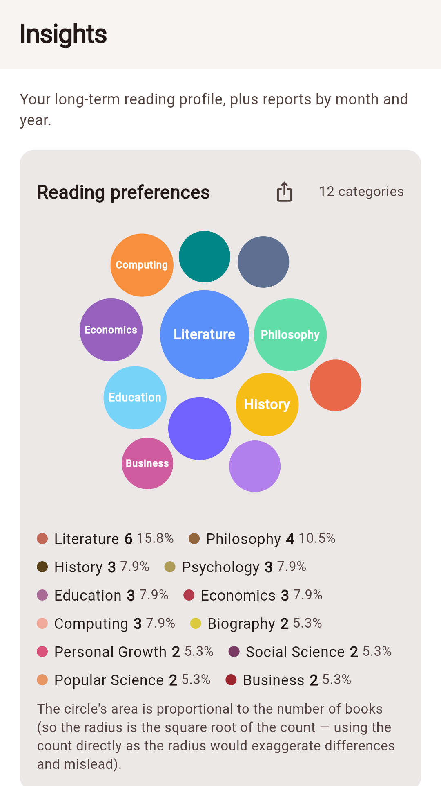
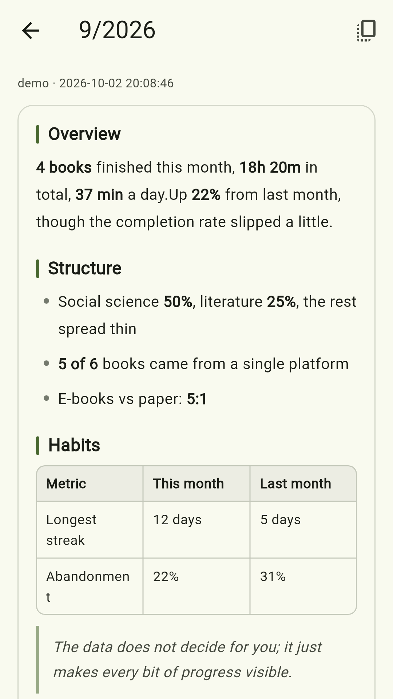

> For a long time my reading records didn't have a home. I couldn't find an app that did this, so I built one: [Readnest](https://kjlintong.github.io/readnest.html). MIT licensed.

---

## 1. Where it started: the table

I read in too many places.

WeRead first, then the school library accounts on Zhangyue and JD Read, plus ebooks I've downloaded myself, and paperbacks borrowed from the library.

For a long time, what held it together was a Notion table. Title, author, status, rating, start and finish dates, plus one line about how it landed. It worked fine at first — reading log, plans and notes all on one table.

After six months or so it just felt like more and more trouble.

To know how many books I'd finished this year I needed a rollup that broke every time I renamed a column. To know my progress on any given platform I had to switch between four apps and copy numbers across. And the worst case was year-end, when I wanted to look back and sum it up — counting rows one by one.

Then there were categories. For the same kind of book I had written, at different times, three different labels. In the table those three were indistinguishable. In any statistic they became three separate categories.

There's a lot of pleasure in reading that comes from looking back. But Notion felt too heavy, and it didn't display well on a phone.

So I built my own. It's called Readnest.

## 2. Three things I decided before writing any code

Three rules for this project.

**It has to work offline.** Nothing essential depends on an account or a network. That's what keeps it private.

**Every source looks the same once it's in.** Wherever a book comes from, it gets normalized into one record before it's stored. Supporting a new source means writing one adapter; the shelf, the statistics and the archives never change. It works the other way too — when you switch platforms, your records aren't locked in with them.

**You hold your own keys.** Some features use a large language model, reading reports for instance. But you apply for the key yourself and paste it into settings. No server on my side, and I hold nothing for you. Use it or don't; everything else works fully offline.

## 3. What Readnest looks like now

Five tabs, left to right.

**Shelf.** Books from every source arrive as the same card: cover, author, category, status, rating. Filter by status, or narrow it to one category or one platform.

**Journal.** Notes and reading plans together. Jot something down mid-book, or set yourself a deadline for one. Reminders are plain local notifications: daily plans ping at nine in the evening, single-book deadlines warn three days ahead.

**Statistics.** Books this year, monthly trend, category mix, rating spread, share by source platform.

**Archive.** My favourite section. Based on books you've **finished and rated**, it draws your taste distribution and generates a set of reading-personality tags. Every tag can be tapped to see which numbers it came from. Export it as an image if you like.

A lot of work went into this. Two hundred philosophy books sitting unread in your wishlist says nothing about your taste — it usually just means one afternoon of bulk importing.

**Settings.** Some personal settings.

## 4. How books get in

This is where most of the work went, because real life offers no single door.

Where there's an open interface, use it. WeRead turned out to have an official developer gateway, far more stable than the cookie-scraping approaches. Exports from Goodreads or Notion can be read directly.

Where there isn't one, use the obvious thing: **a screenshot**. Zhangyue, JD Read and locally stored ebooks offer no public route, so Readnest takes a picture of your shelf and lets the phone read the text off it itself. That happens on your device; the photo goes nowhere.

For library paperbacks, photograph the cover or the spine, then pull author, publisher and page count from a public catalogue.

Duplicates merge automatically, and missing fields get filled in — but **anything you wrote yourself, a rating, a note, a summary, is never overwritten**. That's on purpose. Better to leave one field empty than to wipe something you wrote.

Every platform's own category names go through a shared vocabulary on the way in. The "self-help business" you typed by hand folds into "Management". That lesson came straight from the Notion table.

## 5. The AI parts

I apply one rule to everything that uses a model: **give it the things humans can't do, not the things they can do in a second.**

Reading reports are the clearest case. My first approach was lazy — hand the data over and let it write. What came back was "you read 38 books this year, 3.2 a month", which is exactly what a reader can see for themselves by opening the app. Reading it taught nobody anything.

Now the split is: every number is computed locally, and the model only says what those numbers mean. Nine books spread across nine months and nine books crammed into one are two entirely different readers, and that judgement is worth handing over.

You don't have to assemble reports yourself, or remember to go looking. The annual report generates itself the first time you open the app in the new year, same for the monthly one, and you get a nudge when it's ready.

## 6. What data leaves your phone

This part has to be clear, because it's the difference between trusting an app and not.

What stays on your device: shelf, progress, notes, statistics, settings — all local. Screenshot recognition runs on your phone; the image is never uploaded. Any key you enter is stored in the system keystore, not in plaintext.

Only two things ever go out, and both can be turned off:

**Letting AI tidy up shelf recognition results.** The image **you selected** goes to the model service **you configured**. Every import needs its own tap of consent, you can switch it off at any time, and switching it off drops you back to on-device recognition.

**Generating a reading report.** What goes out is aggregate statistics plus the title, author, category, status and rating of relevant books in that period — so the report can name actual books instead of speaking in generalities. **Note text and highlights are never sent.**

One more thing worth stating: there is no analytics SDK in the app, no advertising SDK, no crash reporting. The sole exception is that the recognition SDK sends Google operational metrics carrying no image content. That's the SDK's own behaviour, the app can't disable it, and it's spelled out in the privacy policy. Don't use screenshot import and no such request is ever made.

## 7. Where it stands

| | |
|---|---|
| Version | v1.0.1, Android package on [GitHub Releases](https://github.com/kjlintong/reading-tracker/releases) |
| Languages | English, 中文, Deutsch, Français, Español |
| Themes | 12 — six solid colours, six textured backgrounds |
| License | [MIT](https://github.com/kjlintong/reading-tracker) |
| iOS | Signing configured, not on the App Store yet |

Looking back, the reason I built this is almost embarrassingly simple: **I just didn't want to maintain that table by hand any more.**

But the real change wasn't the time saved. It was that once looking back costs nothing more than opening the app, you actually do it. A year in review, written for you by you, sitting in the archive tab.

---

Readnest is free. [Source](https://github.com/kjlintong/reading-tracker) and [downloads](https://github.com/kjlintong/reading-tracker/releases/latest) are on GitHub, and the [product page](https://kjlintong.github.io/readnest.html) has more screenshots.

If you're carrying your reading records between apps too, I hope it takes a little off your plate.
